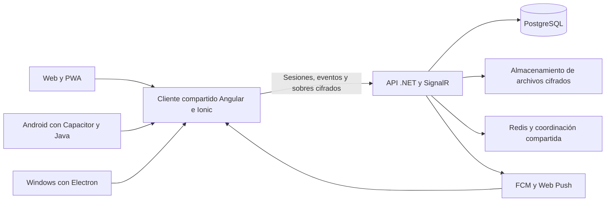

**Nivra 7.7.0: funcionamiento, arquitectura y tamaño del proyecto**

Revisión del código y las comprobaciones locales del 31 de octubre de 2026. Este informe describe lo implementado y la evidencia disponible; no constituye una auditoría criptográfica externa ni una certificación de funcionamiento en todos los teléfonos y redes.

La aplicación tiene una base funcional amplia: mensajería directa y grupal, medios, llamadas, historias, contactos, bóveda, difusión, varias cuentas y clientes para web, Android y Windows. Su siguiente etapa requiere consolidación y pruebas de campo, además de mejoras visuales. Las pruebas automáticas permiten detectar regresiones; las condiciones de batería, red y sistema operativo necesitan validación en dispositivos reales.

La interfaz principal se comparte entre plataformas. Angular 20 e Ionic 8 construyen las pantallas y servicios. La web añade la instalación PWA y notificaciones del navegador; Android usa Capacitor 8 y complementos Java; Windows utiliza Electron 42.11.12, con Chromium y un puente nativo de funciones permitidas. El servidor es ASP.NET Core/.NET 9, con Entity Framework Core 9 y PostgreSQL mediante Npgsql.

El cliente cifra el contenido de los mensajes antes de enviarlo. La API autentica las sesiones, valida permisos, conserva los sobres y recibos, y distribuye eventos mediante SignalR. Los archivos usan almacenamiento de objetos compatible con S3 cuando está configurado. Las llamadas tienen rutas WebRTC y LiveKit; la ruta de salas LiveKit prepara un contexto de cifrado en cliente y activa E2EE. Estas rutas necesitan la infraestructura y compatibilidad correspondientes para funcionar correctamente en redes distintas.

El balanceador de la app conoce tres orígenes de API y comprueba compatibilidad e infraestructura compartida. Si las tres API dependen de la misma base de datos o almacenamiento, una restricción de ese proveedor puede afectar a las tres. Añadir otro servidor API no aumenta la cuota de transferencia de Supabase.

Las funciones presentes en el código se distribuyen así:

| Área | Funcionalidad |
|---|---|
| Acceso y cuentas | Acceso por ID/alias, QR y SMS según configuración, dispositivos vinculados, recuperación y dos cuentas con cambio rápido. |
| Chats | Mensajes, archivos, fotos, video, notas de voz, respuestas, edición, reacciones, búsqueda, favoritos/fijados, archivo, bloqueos y protección local de conversaciones. |
| Estado del mensaje | Información por persona en chats directos y grupos: primera entrega y lectura conocidas, pendientes y actualización desde los recibos disponibles. |
| Selección múltiple | Hasta 100 mensajes, borrado para uno mismo o para todos según permisos, y reenvío conjunto con restricciones y control de operaciones parciales. |
| Sincronización | Historial local, recuperación de llaves existentes y traspasos cifrados aprobados entre dispositivos. La cuenta y el dispositivo tienen espacios separados. |
| Contactos y Mundo | Búsqueda, alias/ID, contactos, solicitudes, descubrimiento y ajustes de privacidad de perfil. |
| Historias | Texto, fotos, video, fragmentos de música, audiencias y visor con interacciones. |
| Difusión | Listas y envíos individuales a varios destinatarios, conservando el cifrado del contenido en el cliente. |
| Bóveda y seguridad local | Notas cifradas, PIN, protección de chats, controles de privacidad y biometría compatible con el dispositivo. |
| Llamadas | Voz, video, salas de grupo y pantalla compartida; funciones adicionales de juegos y traducción local en entornos compatibles. |
| Notificaciones y actualizaciones | FCM, Web Push y funciones de escritorio; cuentas separadas, paquetes Android/Windows y comprobación de versión, firma Android y hashes. |
| Apariencia | Diez idiomas, temas, fondos y preferencias de icono. El icono de una PWA instalada sigue dependiendo de las capacidades y cachés del navegador. |

La versión 7.7 corrige especialmente tres recorridos. Primero, restaura la confianza de contactos en el espacio correcto del dispositivo vinculado y permite continuar automáticamente cuando un dispositivo adicional usa una llave de cifrado exactamente conocida. Segundo, sustituye la información estática del mensaje por datos vigentes, agrupa dispositivos por persona y conserva evidencia ante recibos duplicados o desordenados. Tercero, añade selección múltiple para borrar y reenviar, con cancelación, límites, comprobación de permisos y aislamiento de cuentas. El detalle completo está en [las notas de 7.7.0](release-7.7.0.md).

El recuento usa archivos del repositorio y los archivos nuevos de esta versión, sin dependencias instaladas ni binarios ni salidas de compilación ignoradas. Son **líneas físicas**, incluyendo comentarios y líneas vacías. Las migraciones se separan del código principal. El informe se excluye del recuento para no alterar su propia medición.

| Código principal por área | Archivos | Líneas |
|---|---:|---:|
| Cliente Angular/Ionic | 224 | 70.631 |
| API .NET, sin migraciones | 68 | 14.358 |
| Android nativo | 51 | 6.920 |
| Windows Electron | 9 | 1.129 |
| Herramientas y scripts adicionales | 10 | 1.133 |
| **Total principal** | **362** | **94.171** |

Las cuatro capas de aplicación suman **93.038 líneas**. Con las herramientas son 94.171, de las cuales 86.495 no están vacías. El resto del material textual se reparte así:

| Material separado | Archivos | Líneas |
|---|---:|---:|
| Pruebas | 167 | 25.274 |
| Migraciones y auxiliares generados | 48 | 33.561 |
| Frontend histórico | 9 | 16.732 |
| Traducciones | 10 | 12.482 |
| Archivos de bloqueo de dependencias | 3 | 23.408 |
| Configuración | 74 | 1.796 |
| Documentación, antes de este informe | 67 | 2.525 |
| **Total textual, incluido el principal** | **740** | **209.949** |

Las líneas de una migración, una traducción o una prueba no representan otra pantalla de la app. Tampoco se incluyen aquí los millones de líneas de bibliotecas instaladas. El número sirve para entender el volumen y el mantenimiento; no demuestra por sí solo calidad o seguridad.

Los archivos más grandes merecen atención al mantener el proyecto: `EndpointExtensions.cs` tiene 5.842 líneas, `chat.service.ts` 4.990, `calls.service.ts` 4.011 y `chat-detail.page.ts` 3.974. Separar responsabilidades por mensajes, recibos, medios, sesiones y llamadas puede facilitar cambios futuros y sus pruebas. Conviene hacerlo por etapas con pruebas de regresión.

El tamaño de los instaladores tiene otra explicación: Electron incluye Chromium, Node y archivos de soporte; Android incorpora bibliotecas nativas de comunicación, traducción y varias arquitecturas. La interfaz compartida ocupa una fracción de esos entornos. La compilación web informa **3,09 MB de carga inicial sin comprimir**, con **630,23 kB de transferencia estimada**; quedan avisos de presupuesto del bundle inicial y de algunos estilos existentes. Este valor no representa todo el contenido que se descarga al usar funciones diferidas ni el historial de un usuario.

En los paquetes finales medidos, el APK ocupa **143.128.933 bytes** (aproximadamente 143 MB) y el instalador Windows **105.654.545 bytes** (aproximadamente 106 MB). La carpeta Windows instalada suma unos **382 MB**: el ejecutable de Electron aporta 235 MB, los archivos web compartidos unos 7,3 MB y `app.asar` unos 426 kB. En Android, las entradas nativas de traducción suman 62,6 MB, WebRTC 47,6 MB y SQLCipher 19,4 MB, cada biblioteca repartida en cuatro arquitecturas. Esas cifras de bibliotecas corresponden al tamaño sin comprimir de las entradas del APK. Se puede evaluar distribución por arquitectura para reducir descargas futuras, conservando la compatibilidad y el flujo de actualización.

La seguridad necesita valorarse por capas. El código de mensajes revisado usa ECDH P-256 y AES-GCM de 256 bits, con un IV aleatorio. La confianza se recuerda localmente y puede trasladarse dentro de una vinculación cifrada y aprobada. Un cambio de llave de cifrado desconocido conserva la comparación manual; esta versión no incorpora un registro independiente de transparencia de llaves.

En la ruta de cifrado revisada se derivan claves a partir de identidades persistentes. No se observa en esa ruta una rotación por mensaje equivalente a Double Ratchet, por lo que no debe atribuirse automáticamente la misma garantía de secreto hacia adelante de otros protocolos. Una auditoría externa y un diseño de evolución del protocolo son prioridades antes de hacer afirmaciones como «indescifrable».

Android y Windows tienen un protector nativo para secretos. La ruta web puede conservar material privado en el almacén del navegador cuando no existe ese protector. Por ello, deben revisarse la protección de llaves ligada al desbloqueo en web/PWA, los controles de origen, CSP/XSS y el acceso local al perfil del navegador. Un teléfono o equipo desbloqueado y comprometido puede exponer contenido que el cliente ya puede leer. El servidor también necesita metadatos de cuentas, dispositivos, destinatarios y tiempos para enrutar mensajes; cifrar el contenido no elimina todos esos metadatos.

En la revisión de dependencias de producción apareció un aviso de severidad alta en la dependencia transitiva `re2js` 2.8.6. Se actualizó únicamente ese paquete a 2.9.1, dentro del rango ya permitido. El aviso [GHSA-gg6h-894w-4m9c](https://github.com/advisories/GHSA-gg6h-894w-4m9c) describe consumo cuadrático de CPU bajo patrones y opciones específicos; encontrar la dependencia no demuestra que esa ruta se explotara en Nivra. Después de la actualización, los análisis de producción del cliente, la raíz y escritorio y la consulta de paquetes transitivos de la API no informaron vulnerabilidades conocidas. La suite principal se repitió con éxito después del cambio. La recompilación generó los mismos archivos web que los paquetes ya probados: se comprobó su coincidencia por SHA-256 en Android, Windows y ZIP.

La API utiliza .NET 9, cuyo soporte finaliza el **10 de noviembre de 2026**, según la [política oficial de Microsoft](https://dotnet.microsoft.com/en-us/platform/support/policy/dotnet-core). Debe planificarse la migración a una versión LTS soportada antes de esa fecha, validando EF Core, Npgsql, compilación e infraestructura. Esa migración mayor no forma parte del parche 7.7.

La validación funcional de este cierre incluye **1.469 pruebas de aplicación, dos pruebas WebRTC aisladas y 48 de escritorio: 1.519 comprobaciones distintas**. Hay una prueba con WebCrypto e IndexedDB reales que recorre el traspaso de confianza cifrado; las solicitudes de servidor se controlan mediante un entorno de pruebas. Se revisaron visualmente seguridad e información de mensajes a 320, 390 y 1.200 píxeles, en claro y oscuro. Esto no equivale a una auditoría de penetración ni a una prueba de todas las redes y modelos de teléfono.

En una única sesión de emulador Android se instaló el APK firmado 7.7.0, build 49, y se comprobó la apertura de Bienvenida y su navegación al acceso. El emulador presentaba fallos de su servicio Bluetooth; se desactivó Bluetooth en ese entorno temporal para completar la apertura. No se observaron fallos del proceso de Nivra en el registro de excepciones. Esta prueba básica no valida llamadas Bluetooth ni confirma entrega de mensajes entre teléfonos físicos.

Para consolidar el uso diario, las prioridades siguientes son medir el tráfico real de PostgreSQL y almacenamiento; probar dos dispositivos y dos cuentas con pantalla apagada, ahorro de batería y cambios entre Wi-Fi/datos; validar TURN/LiveKit en redes restrictivas; medir chats e historiales grandes; y revisar el protocolo y la protección de llaves con una auditoría independiente. Las notificaciones dependen también de permisos, sistema operativo, red y estado del proveedor, y no pueden prometerse infalibles con la app forzada a detenerse o sin conexión.

Los instaladores históricos retirados de la carpeta de trabajo tienen respaldo en las publicaciones de GitHub. Los 48 archivos que faltaban se añadieron al [archivo histórico](https://github.com/AnthonyManzanoC/Nivrapp-secure/releases/tag/archivo-historico-instaladores-20261030); se verificaron en conjunto 120 paquetes por nombre, tamaño y SHA-256. La limpieza local recuperó espacio sin eliminar el código del proyecto.

Fuentes principales de esta revisión: [API](../Nivra.Api/Endpoints/EndpointExtensions.cs), [modelo y datos](../Nivra.Api/Infrastructure/NivraDbContext.cs), [mensajería](../nivra-app/src/app/core/services/chat.service.ts), [cifrado](../nivra-app/src/app/core/services/crypto.service.ts), [confianza](../nivra-app/src/app/core/services/identity-trust.service.ts), [llamadas](../nivra-app/src/app/core/services/calls.service.ts), [protector nativo](../nivra-app/src/app/core/services/native-secure-vault.service.ts), [cliente Windows](../Nivra.Desktop/main.js) y [dependencias del cliente](../nivra-app/package.json).
