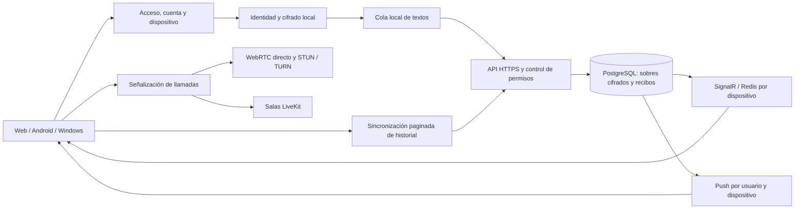

# Revisión funcional y de estabilidad de Nivra

Fecha: 14 de noviembre de 2026, America/Bogota. Base revisada: `ebac7ae`, versión 9.2.0. Las correcciones de esta revisión están en el checkout local; este documento no anuncia una publicación nueva.

## Resultado

Nivra tiene implementada una plataforma de mensajería amplia, pero sus fallos intermitentes no se explican con una sola causa. Se reprodujeron defectos de concurrencia, notificación después de guardar, persistencia local y apertura nativa de llamadas. La comprobación pública también encontró un servidor suspendido, respuestas inicialmente lentas y ausencia de TURN configurado en los dos servidores operativos.

La revisión abarcó arquitectura, rutas, servicios críticos, integración Android/Windows, pruebas existentes, dependencias y consultas públicas sin autenticación. No fue una auditoría exhaustiva de cada línea ni una prueba con usuarios y teléfonos físicos. Se conservaron cuentas, sesiones, claves existentes y datos de producción.

## Cómo funciona

El cliente cifra antes de enviar; el servidor valida cuenta, dispositivo, pertenencia y formato, guarda el sobre y después intenta los avisos. Guardar un mensaje, avisar al receptor y que el receptor lo lea son etapas distintas. La sincronización permite recuperar mensajes guardados cuando una conexión o aviso se pierde. Recuperar el acceso a una cuenta tampoco implica recuperar automáticamente todas las llaves y mensajes antiguos.

La interfaz Angular/Ionic comparte servicios entre web, Android con Capacitor y Windows con Electron. Android añade push, almacenamiento protegido y ciclo de vida nativo. Electron protege secretos con el sistema operativo y usa notificaciones mientras la aplicación está ejecutándose. Las llamadas directas usan WebRTC; las salas grupales requieren LiveKit y sus claves.

## Fallos confirmados y cambios aplicados

| Área | Antes y condición que lo dispara | Corrección local | Evidencia |
| --- | --- | --- | --- |
| Reconexión | Si detener el hub anterior tarda, una operación antigua puede abrir otro después de desconectar o cambiar de cuenta. | Validar propietario y generaciones de cuenta/conexión antes de crear el transporte. | Dos fallos reproducidos con el código anterior; tres regresiones nuevas y 20 pruebas focalizadas aprobadas. |
| Entrega de mensajes | SignalR puede fallar después del commit, devolver error al emisor e impedir avisar a los otros dispositivos y por push. | Aislar errores por destinatario y transporte; conservar el éxito del guardado y continuar los demás avisos. | Cuatro aserciones nuevas de infraestructura. Cubre `/messages` y `/messages/ratchet`. |
| Secretos Windows | Un error de disco durante la creación puede dejar el protector definitivo truncado y bloquear accesos posteriores. | Escribir un temporal exclusivo, sincronizarlo y publicarlo completo sin sobrescribir otro inicializador. | Inyección de escritura parcial, fallo de sincronización y creación concurrente. |
| Borrado Windows | Un temporal que sobrevive a una interrupción o fallo de limpieza puede conservar un protector después de solicitar su borrado. | Borrar también los temporales del nombre autorizado, con patrón estricto, e informar si el borrado no pudo completarse. | Regresión detectada durante revisión cruzada de la corrección y cubierta por pruebas. |
| Llamada activa Android | Pulsar la notificación de una llamada activa genera un intent sin el marcador que exige el receptor. Reutilizar el marcador de entrada también lo haría caducar. | Ruta firmada específica para llamada activa, independiente del vencimiento de la llamada entrante y vinculada a la cuenta. | Cableado verificado y pruebas instrumentadas añadidas; compiladas, pendientes de ejecución en dispositivo. |
| Selección de API | El cliente conserva un servidor suspendido entre candidatos y la configuración nativa lo prefiere al arrancar. | Mantener los dos nodos operativos y alinear la preferencia nativa con el principal. | Respuesta pública 503 con página de servicio suspendido; dos nodos compatibles y con la misma huella. |
| Versión informada | La constante del servidor seguía en 9.1.0 mientras paquetes, instaladores y web declaraban 9.2.0. | Alinear la constante y comprobar paridad antes de entregar versiones. | 19 controles de metadatos y verificación añadida a `verify-release.ps1`. |
| Seguridad del servidor | La auditoría detectó una vulnerabilidad alta en SignalR Redis 9.0.16. | Actualizar el paquete a 9.0.23 y fijar el runtime Docker en ASP.NET 9.0.23. | Compilación correcta, 270 aserciones repetidas tras actualizar y auditoría NuGet posterior sin paquetes vulnerables detectados. |

El cambio de avisos no introduce una cola durable del servidor: una caída del proceso o cancelación después del commit todavía puede dejar avisos sin ejecutar. El mensaje guardado se recupera por sincronización. Ese caso necesita una mejora adicional de arquitectura si se quiere garantizar reintento durable de los avisos.

El [aviso oficial de Microsoft](https://github.com/dotnet/announcements/issues/509) describe una fuga de suscripciones en SignalR con Redis que puede agotar recursos y exige actualizar tanto el paquete como el runtime. Encontrar una dependencia afectada no demuestra que los fallos observados fueran una explotación. La imagen oficial 9.0.23 está disponible; no se construyó ni desplegó aquí. El runtime instalado en este equipo sigue en 9.0.12, por lo que la corrección operativa del servidor requiere la nueva imagen.

## Servicio público observado

Se realizaron consultas GET sin credenciales y sin crear cuentas, enviar mensajes o modificar configuración.

| Destino | Observación |
| --- | --- |
| `nivrapp-secure-eaqi.onrender.com/health/ready` | Primera consulta superó 25 s; consultas posteriores HTTP 200, aproximadamente 0,6–4,9 s. |
| `nivra-webapp-secure.onrender.com/health/ready` | Primera consulta superó 25 s; consultas posteriores HTTP 200, aproximadamente 0,6–4,8 s. |
| `nivrapp-secure.onrender.com/health/ready` | HTTP 503, página del proveedor: servicio suspendido por su propietario. |
| Web `/assets/release.json` y feed público | Informan 9.2.0. Los metadatos Android informan build 58. No se descargaron de nuevo los instaladores completos en esta revisión. |
| Dos API operativas | Misma huella de clúster, protocolos compatibles y flags de almacenamiento compartido, Redis, firma estable y push habilitados. |
| TURN | Ambas API informan `webrtcRelayConfigured=false`. Esto deja sin respaldo de relay algunas redes restrictivas. |

La API pública declara 9.1.0, pero se encontró la misma constante antigua en el código local 9.2.0. Por tanto, esa etiqueta sola no permite concluir que el servidor ejecuta código viejo. Los flags de push son evidencia de configuración; no demuestran entrega con una aplicación cerrada. La lentitud inicial es una observación, no una prueba de su causa en el proveedor.

El diagnóstico `tools/check-api-cluster.ps1` ahora muestra y advierte sobre TURN por separado. Una API preparada puede coexistir con llamadas que no conectan.

## Estado por función

| Función | Qué se revisó o comprobó | Qué falta para validación de uso real |
| --- | --- | --- |
| Registro, acceso y sesiones | Rutas protegidas, límites de autenticación, restauración, aislamiento por cuenta y dispositivos. | Ensayo completo de alta/recuperación con cuentas de prueba; concurrencia de renovación entre pestañas. |
| Contactos, invitaciones y bloqueo | Permisos, privacidad, solicitudes, bloqueos bidireccionales y consultas. | Invitaciones entre plataformas y contacto bloqueado durante una conversación activa. |
| Mensajes privados y grupos | Cifrado, cola de textos, reconexión, idempotencia, recibos y avisos después de guardar. | Wi-Fi a datos móviles, respuestas perdidas, cierre del proceso y acumulaciones grandes. |
| Adjuntos | Contexto cifrado, validación de subida, autorización de archivos y descarga. | Interrumpir y repetir cargas grandes en red móvil; espacio insuficiente. |
| Historial y multidispositivo | Llaves, transferencias autorizadas, tombstones y consultas SQL. | Origen sin conexión, nuevo equipo, reinicio durante transferencia y restauración con copias reales de prueba. |
| Historias / Mundo | Audiencia, publicación, acceso a archivos, consumo y feed por lotes. | Vídeo, audio y publicación con permisos revocados en dispositivos reales. |
| Comunidades y difusión | Rutas, servicios, pruebas de cliente y permisos de pertenencia. | Recorridos completos de invitación, cambio de rol, difusión y salida con varias cuentas de prueba. |
| Bóveda y salas | Aislamiento por cuenta, invitaciones, reconexión y carga diferida. | Salas LiveKit, permisos y redes lentas; revisar timeouts específicos. |
| Incógnito | Suite del cliente, entrada/salida, reconexión y límites de sesión. | Alternar red y suspensión del equipo durante la sala. |
| Llamadas directas | Coordinación, propiedad por equipo/pestaña, señalización, ICE y entrada desde notificaciones. | TURN operativo; llamadas físicas entre operadores, Bluetooth, bloqueo y batería. |
| Llamadas grupales, pantalla y traducción | Carga de LiveKit, llaves y controles automatizados existentes. | Medios reales, permisos, cambio de dispositivos y conectividad con servidor de salas. |
| Notificaciones | Registro por cuenta/dispositivo, rutas nativas, cancelaciones y estado del proveedor. | Entrega FCM/WebPush real con aplicación cerrada, batería restringida y distintos fabricantes. |
| Windows | Protector seguro, límites IPC, actualización y pruebas de escritorio. | Instalación/actualización del nuevo artefacto y permisos/notificaciones del sistema. |
| iOS | Dependencias compartidas y límite documentado del repositorio. | Proyecto nativo, firma Apple y pruebas iPhone; no existe entrega iOS validada aquí. |
| Planes y anuncios | Endpoints presentes en el código. | Integración comercial y pruebas de pagos/suscripciones, si ese es el objetivo de negocio. |

## Prioridad de las siguientes mejoras

1. **Operación de llamadas:** provisionar TURN autenticado y verificar que realmente transporta audio/vídeo entre redes que no permiten conexión directa. Aceptación: conexión relay comprobada en estadísticas ICE y llamada bidireccional estable; un flag de configuración no basta.
2. **Entrega durable:** guardar trabajos de aviso en la misma transacción del mensaje y procesarlos con reintento, deduplicación y métrica de antigüedad. Aceptación: matar el proceso después del commit y verificar aviso posterior sin duplicar mensaje.
3. **Redes lentas:** reproducir operaciones de Bóveda con límite de 12 s y Ratchet/historial con límites de 15 s frente a la política general de 30–120 s. Aceptación: retrasos controlados no pierden borradores, claves ni estado; la cancelación del usuario sigue funcionando.
4. **Sesión entre pestañas:** comprobar dos renovaciones HTTP simultáneas. `TokenService` lee y rota antes de guardar; el singleflight del cliente es por instancia. Si se reproduce la carrera, coordinar la rotación en servidor y el almacenamiento local. Es un riesgo de código pendiente de reproducción.
5. **Volumen:** paginar el endpoint legacy de mensajes pendientes, que no tiene el `Take` usado por sincronización normal. Ensayar miles de pendientes y medir memoria/latencia antes de fijar metas de capacidad.
6. **Visibilidad operativa:** registrar latencia, fallos por transporte, antigüedad de colas y resultado ICE, con identificadores técnicos sin texto de mensajes ni secretos. Alertar sobre cambios significativos y probar reinicio de API/Redis.
7. **Rendimiento percibido:** medir arranque, memoria y batería en un teléfono modesto. La compilación conserva unos 2,73 MB iniciales y avisos de tamaño; ese dato por sí solo no mide fluidez.

Estas mejoras tienen criterios de aceptación distintos. Las pendientes de infraestructura y hardware no se pueden completar cambiando únicamente el cliente.

## Pruebas de esta revisión

- Cliente completo: **1.663/1.663** pruebas aprobadas, incluidas tres regresiones nuevas de reconexión. Base anterior: 1.660 aprobadas.
- Servidor: **615 aserciones** en 13 suites aisladas aprobadas, más el control SQL de PostgreSQL sin abrir conexión. Cubren metadatos de cuenta, bloqueo de app, frontera de autenticación, llamadas, contactos, historial, identidad, infraestructura, push, releases, seguridad y social/historias.
- Tras actualizar SignalR: repetidas **270 aserciones** de infraestructura, llamadas, seguridad y frontera de autenticación; compilación de API con **0 advertencias y 0 errores**.
- Node: **105/105** pruebas aprobadas entre Electron, integración nativa, notificaciones y endpoints de descarga/feed. Incluyen **56** de Electron y **19** de los checks nativos revisados.
- Android: **72/72** pruebas JVM aprobadas. Java e instrumentación compilan en el paquete aislado de laboratorio. Tres pruebas instrumentadas nuevas compiladas, **no ejecutadas** porque no hay dispositivo ADB conectado.
- Metadatos de versión: **19** controles dentro del total anterior. El verificador de entrega rechaza una versión de compatibilidad diferente.
- Clúster: **31** escenarios simulados aprobados, sin red. Consulta real de los dos nodos aceptados con huella esperada aprobada, con advertencia de TURN.
- Feed de entrega: **20** controles offline aprobados.
- Motor criptográfico: distribución híbrida verificada y **9/9** pruebas de interoperabilidad, rotación, replay, recepción y prekeys aprobadas.
- Compilación de producción web: aprobada; conserva avisos de presupuesto y plantillas existentes. No se aumentaron presupuestos para ocultarlos.
- Dependencias npm: **0 alertas altas/críticas**; se mantienen 3 moderadas en raíz, 33 en cliente y 3 en escritorio, con paquetes compartidos entre informes. No se aplicaron migraciones mayores automáticas sugeridas por `npm audit fix --force`.
- Auditoría NuGet con transitivas: detectó inicialmente el aviso alto de SignalR; tras actualizar a 9.0.23 no detecta paquetes vulnerables. Esto no sustituye actualizar el runtime de producción.
- Metadatos del verificador: comprobado que rechaza 9.1.0 antes de inspeccionar artefactos y que acepta la paridad de 9.2.0. `git diff --check` aprobado.

Los resultados completos y el muestreo público están en `artifacts/reliability-2026-11-14/`, que es un directorio local ignorado por Git. Las pruebas PostgreSQL de integración que requieren una base aislada y las pruebas físicas no se ejecutaron en esta revisión. No se aplicaron migraciones de producción.

## Recorrido de aceptación en dispositivos

Usar cuentas y equipos de prueba, con dos participantes y al menos un teléfono Android, una sesión web y Windows. Registrar sistema, fabricante, versión, red, hora, acción, resultado y duración.

| Escenario | Resultado necesario |
| --- | --- |
| Escribir sin red, reconectar y reabrir | Texto conservado, envío único, estado coherente y recepción confirmada. |
| Cambiar Wi-Fi/datos y alternar cuentas | Reconexión solo de la cuenta vigente; ningún contenido o aviso de otra cuenta. |
| Cerrar el proceso justo después de enviar | Historial se reconcilia al volver; no se duplica el mensaje ni se borra el siguiente borrador. |
| Llamar con pantalla bloqueada y abrir notificación activa después de 75 s | Se abre la llamada correcta de la cuenta correcta y sigue disponible el botón de colgar. |
| Llamar entre dos redes restrictivas | Audio/vídeo bidireccional por relay verificado; resultado registrado también para Bluetooth. |
| Revocar dispositivo o bloquear contacto | Acciones rechazadas y contenido de otras cuentas inaccesible. |
| Recuperar acceso e historial | Se explica y verifica cada etapa por separado; no se promete historial que ya no tiene copia autorizada. |
| Publicar historia, invitar comunidad y compartir bóveda | Audiencia y permisos respetados antes y después de cambiar pertenencia. |
| Espacio insuficiente o almacenamiento bloqueado | Error recuperable y explícito; ninguna sustitución silenciosa de llaves existentes. |
| Actualizar desde la versión instalada | Firma y versión correctas; continuidad de cuentas, secretos e historial comprobada. |

No se generaron ni publicaron nuevos APK/EXE en esta revisión. La validación de instaladores debe hacerse sobre los artefactos nuevos después de incorporar y compilar estos cambios.
